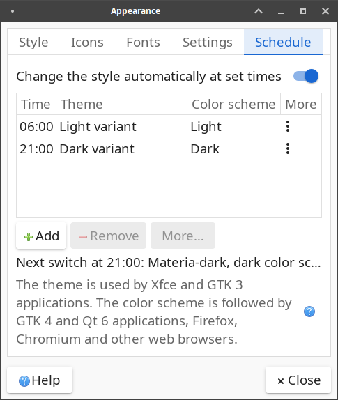

# XFCE-patches

Extra features for XFCE components on **Xubuntu 26.04 (resolute)** (and ports to
**24.04 (noble)**), packaged as drop-in replacement `.deb`s built by GitHub Actions.

## Features

### Theme schedule (xfce4-settings)

A **Schedule** tab in *Settings → Appearance* switches the style at set times,
e.g. to a dark theme in the evening and back to light in the morning.
Any number of rules "at HH:MM switch the style"; each rule can change:

- **Theme** — the dark or light variant of whatever theme is active at that moment
  (found case-insensitively: Greybird → Greybird-dark, Orchis-Compact → Orchis-Dark-Compact),
  or a specific theme.
- **Color scheme** — the dark/light preference that GTK 4/libadwaita, Qt 6, Firefox,
  Chromium and Electron apps read through the settings portal.
- **More…** — the matching xfwm4 theme (follows "Set matching Xfwm4 theme" by default),
  the icon theme, the cursor theme, the screen brightness of a laptop (in percent,
  set through logind, no root needed), or a shell command to run.



The rules live in xfconf (`xsettings:/Xfce/ThemeSchedule/`) and are applied by
xfsettingsd, so the dialog does not need to be open. A rule fires when the clock
passes its time, so a manual change stays until the next rule; a switch missed
while logged out is applied at login. Translated into all Xfce languages
(machine translations, not yet reviewed). Sunrise/sunset rules are planned.

## Install

Download the `.deb`s for your Xubuntu release from
[Releases](https://github.com/gtubolcev/xfce-patches/releases/latest)
(`*_4.20.1-*` for 26.04, `*_4.18.4-*` for 24.04 — the 24.04 build is untested),
put them into an empty folder, then:

```bash
sudo apt install ./*.deb
```

and log out and back in. The packages replace the stock ones (version suffix
`+xfcepatches1+<release>`, e.g. `+xfcepatches1+v0.1.2`); to go back, reinstall the Ubuntu version with
`sudo apt install --reinstall --allow-downgrades xfce4-settings=<version> xfce4-helpers=<version>`.

The code was written with an AI assistant (Claude) and has not been reviewed by
an Xfce developer.

## Development

Docs: <https://docs.xfce.org/start> · <https://docs.xubuntu.org/> · upstream code: <https://gitlab.xfce.org>

### Layout

```
packages/<source-package>/
    BASE            upstream tag the patches are based on (e.g. thunar-4.20.7)
    patches/        *.patch (git format-patch, DEP-3 friendly) + series
    <codename>/     optional port to an older Ubuntu release (e.g. noble),
        BASE            with its own BASE and patches/
        patches/
scripts/
    setup-dev.sh        one-time: enable deb-src, install toolchain (sudo)
    fetch-upstream.sh   clone upstream git at the installed version -> src/<pkg>
    export-patches.sh   commits on src/<pkg> (branch work) -> packages/<pkg>/patches
    build-package.sh    apt-get source + our patches -> .deb (used by CI too)
src/                upstream working clones (git-ignored)
```

### Workflow

```bash
sudo scripts/setup-dev.sh                 # once
scripts/fetch-upstream.sh thunar          # clone gitlab.xfce.org/xfce/thunar @ thunar-4.20.7
cd src/thunar && meson setup build && ninja -C build   # hack, test, git commit
scripts/export-patches.sh thunar          # -> packages/thunar/patches/
scripts/build-package.sh thunar           # optional local .deb build -> out/
git push                                  # CI builds debs-thunar artifact
git tag v0.1.0 && git push --tags         # CI attaches all .debs to a release
```

Packages get the version suffix `+xfcepatches1` (e.g. `4.20.7-1+xfcepatches1`), so they
sort above the archive version; release builds append the tag
(`4.20.7-1+xfcepatches1+v0.1.2`), so each release upgrades the previous one. When Ubuntu ships a newer version, rebase the
patches (`fetch-upstream.sh` on the new tag, `git rebase`, `export-patches.sh`).
To pin our build: `sudo apt-mark hold <pkg>`.

#### Older Ubuntu releases

Xubuntu 24.04 (noble) ships older Xfce versions, so the patches are ported
there separately: a branch named after the release in the same upstream
clone, based on noble's upstream tag (e.g. a worktree at `src/<pkg>-noble`).

```bash
git -C src/xfce4-settings worktree add -b noble ../xfce4-settings-noble xfce4-settings-4.18.4
mkdir -p packages/xfce4-settings/noble && echo xfce4-settings-4.18.4 > packages/xfce4-settings/noble/BASE
# cherry-pick the commits from work, fix conflicts, build, test
scripts/export-patches.sh xfce4-settings noble   # -> packages/xfce4-settings/noble/patches/
```

CI builds every package for 26.04 and, if `packages/<pkg>/<codename>/` exists,
also in an `ubuntu:<codename>` container; a release gets the `.deb`s of all of them.

A manual run (Actions → build → Run workflow) with a package name builds any
source package, patched or not.

## License

GPL-2.0-or-later, the same as the Xfce components the patches apply to
(see [LICENSE](LICENSE)). Each patch is a derivative of its upstream project and
falls under that project's license.
