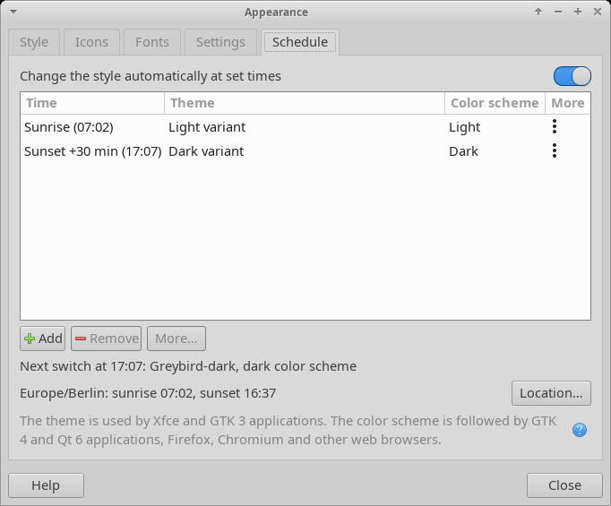

# XFCE-patches

Extra features for XFCE components on **Xubuntu 26.04 (resolute)** (and ports to
**24.04 (noble)**), packaged as drop-in replacement `.deb`s built by GitHub Actions.
Test builds for **Debian 13 (trixie)** and **Arch Linux** too.

Other projects that used to live here have repositories of their own:
[thunar-disk-usage](https://github.com/gtubolcev/thunar-disk-usage) (a Thunar
plugin), [xfce4-speech-settings](https://github.com/gtubolcev/xfce4-speech-settings)
(a speech settings dialog) and [linux-tts](https://github.com/gtubolcev/linux-tts)
(neural voices for speech-dispatcher).

## Features

### Theme schedule (xfce4-settings)

A **Schedule** tab in *Settings → Appearance* switches the style at set times,
e.g. to a dark theme in the evening and back to light in the morning.
Any number of rules "at HH:MM switch the style" — or at sunrise or sunset, also some
minutes before or after (e.g. "Sunset +30 min"). Sunrise and sunset are computed for
the location of the time zone, or for a city or coordinates set under *Location…*.
Each rule can change:

- **Theme** — the dark or light variant of whatever theme is active at that moment
  (found case-insensitively: Greybird → Greybird-dark, Orchis-Compact → Orchis-Dark-Compact),
  or a specific theme.
- **Color scheme** — the dark/light preference that GTK 4/libadwaita, Qt 6, Firefox,
  Chromium and Electron apps read through the settings portal.
- **More…** — the matching xfwm4 theme (follows "Set matching Xfwm4 theme" by default),
  the icon theme, the cursor theme, the screen brightness of a laptop (in percent,
  set through logind, no root needed), a warmer **color temperature** of the screen
  ("night light", e.g. 4500 K, reached gradually over a number of minutes), or a shell
  command to run.

The color temperature works on X11 only. It is set through XRandR gamma ramps,
multiplied onto the ones already loaded, so a color profile stays in effect. It
stays until a later rule sets another temperature: set 6500 K (normal) in the
morning rule. Several rules give any curve, e.g. 5000 K at sunset, 3500 K at
22:00, 6500 K at sunrise. Don't run redshift, gammastep or a similar tool at the
same time, they would overwrite each other.



The rules live in xfconf (`xsettings:/Xfce/ThemeSchedule/`) and are applied by
xfsettingsd, so the dialog does not need to be open. A rule fires when the clock
passes its time, so a manual change stays until the next rule; a switch missed
while logged out is applied at login. Translated into all Xfce languages
(machine translations, not yet reviewed).

### Disk usage in Thunar (plugin)

Moved to [gtubolcev/thunar-disk-usage](https://github.com/gtubolcev/thunar-disk-usage).

## Install

Download the `.deb`s for your Xubuntu release from
[Releases](https://github.com/gtubolcev/xfce-patches/releases/latest)
(`*_4.20.1-1ubuntu*` for 26.04, `*_4.18.4-*` for 24.04 — the 24.04 build is untested;
`*_4.20.1-1+xfcepatches*` for Debian 13),
put them into an empty folder, then:

```bash
sudo apt install ./*.deb
```

and log out and back in. The packages replace the stock ones (version suffix
`+xfcepatches1+<release>`, e.g. `+xfcepatches1+v0.1.2`); to go back, reinstall the Ubuntu version with
`sudo apt install --reinstall --allow-downgrades xfce4-settings=<version> xfce4-helpers=<version>`.

On Arch Linux (also Manjaro, EndeavourOS) install
`xfce4-settings-xfcepatches-*.pkg.tar.zst` from the same page with
`sudo pacman -U ./xfce4-settings-xfcepatches-*.pkg.tar.zst`; it replaces
`xfce4-settings`, and `sudo pacman -S xfce4-settings` goes back. The Debian and
Arch builds are untested.

The code was written with an AI assistant (Claude) and has not been reviewed by
an Xfce developer.

## Development

Docs: <https://docs.xfce.org/start> · <https://docs.xubuntu.org/> · upstream code: <https://gitlab.xfce.org>

### Layout

```
packages/<source-package>/
    BASE            upstream tag the patches are based on (e.g. thunar-4.20.7)
    patches/        *.patch (git format-patch, DEP-3 friendly) + series
    <codename>/     optional port to an older Ubuntu release (e.g. noble),
        BASE            with its own BASE and patches/
        patches/
    arch/           optional port to Arch Linux: BASE, patches/, PKGBUILD
                    and the files the PKGBUILD needs
scripts/
    setup-dev.sh        one-time: enable deb-src, install toolchain (sudo)
    fetch-upstream.sh   clone upstream git at the installed version -> src/<pkg>
    export-patches.sh   commits on src/<pkg> (branch work) -> packages/<pkg>/patches
    build-package.sh    apt-get source + our patches -> .deb (used by CI too)
    build-arch.sh       packages/<pkg>/arch -> makepkg -> .pkg.tar.zst (CI)
    upload-ppa.sh       signed source package -> Launchpad PPA (CI, on tags)
    screenshot.sh       docs/theme-schedule.png from the built .debs (CI commits
                        it after each push to main when the dialog changed)
src/                upstream working clones (git-ignored)
```

### Workflow

```bash
sudo scripts/setup-dev.sh                 # once
scripts/fetch-upstream.sh thunar          # clone gitlab.xfce.org/xfce/thunar @ thunar-4.20.7
cd src/thunar && meson setup build && ninja -C build   # hack, test, git commit
scripts/export-patches.sh thunar          # -> packages/thunar/patches/
scripts/build-package.sh thunar           # optional local .deb build -> out/
git push                                  # CI builds debs-thunar artifact
git tag -a v0.1.0 -m "What is new" && git push --tags   # release: the message + all .debs
```

Packages get the version suffix `+xfcepatches1` (e.g. `4.20.7-1+xfcepatches1`), so they
sort above the archive version; release builds append the tag
(`4.20.7-1+xfcepatches1+v0.1.2`), so each release upgrades the previous one. When Ubuntu ships a newer version, rebase the
patches (`fetch-upstream.sh` on the new tag, `git rebase`, `export-patches.sh`).
To pin our build: `sudo apt-mark hold <pkg>`.

#### Older Ubuntu releases

Xubuntu 24.04 (noble) ships older Xfce versions, so the patches are ported
there separately: a branch named after the release in the same upstream
clone, based on noble's upstream tag (e.g. a worktree at `src/<pkg>-noble`).

```bash
git -C src/xfce4-settings worktree add -b noble ../xfce4-settings-noble xfce4-settings-4.18.4
mkdir -p packages/xfce4-settings/noble && echo xfce4-settings-4.18.4 > packages/xfce4-settings/noble/BASE
# cherry-pick the commits from work, fix conflicts, build, test
scripts/export-patches.sh xfce4-settings noble   # -> packages/xfce4-settings/noble/patches/
```

CI builds every package for 26.04 and Debian 13 (trixie, with the same patches
unless `packages/<pkg>/trixie/` exists) and, if `packages/<pkg>/<codename>/`
exists, also in an `ubuntu:<codename>` container; a release gets the packages of
all of them.

#### Arch Linux

Arch follows upstream bugfix releases, so the port is based on a newer tag, in
the same way (branch `arch`, worktree `src/<pkg>-arch`, `export-patches.sh
<pkg> arch`). `packages/<pkg>/arch/PKGBUILD` follows Arch's own PKGBUILD, with a
package name of its own (`<pkg>-xfcepatches`, provides and conflicts with
`<pkg>`) so that a stock update does not replace it. CI builds it in an
`archlinux` container with `scripts/build-arch.sh`; the Ubuntu PPA gets only
the Ubuntu builds.

A manual run (Actions → build → Run workflow) with a package name builds any
source package, patched or not.

## Prior art

The theme schedule borrows ideas, not code, from these projects. Thanks to
their authors and contributors.

Sunrise and sunset:

- [NOAA Solar Calculator](https://gml.noaa.gov/grad/solcalc/calcdetails.html)
  formulas (NOAA Global Monitoring Laboratory). `common/sun-times.h` in xfce4-settings is our own
  implementation of them. GNOME Night Light uses the same method
  ([gnome-settings-daemon](https://gitlab.gnome.org/GNOME/gnome-settings-daemon),
  © Richard Hughes and others).
- [Night Theme Switcher](https://gitlab.com/rmnvgr/nightthemeswitcher-gnome-shell-extension),
  a GNOME Shell extension (© Romain Vigier and others). We compared its
  features with ours.
- [Auto Dark Mode for Windows](https://github.com/AutoDarkMode/Windows-Auto-Night-Mode)
  (© Armin Osaj, Sam Spiritreader and others). We compared its features with
  ours.

Rules and theme switching:

- [xfce4-night-mode](https://github.com/bimlas/xfce4-night-mode), a genmon
  script for Xfce (© Bimba László and others). It was the main source of ideas:
  a temporary manual switch, a dark panel, commands for the wallpaper, and
  working together with Redshift.
- [Redshift](https://github.com/jonls/redshift) (© Jon Lund Steffensen and
  others) and its fork
  [Gammastep](https://gitlab.com/chinstrap/gammastep) (© Cameron Nemo and
  others). Users ran period-changed hooks to switch the theme before this
  patch existed.
- [darkman](https://gitlab.com/WhyNotHugo/darkman) (© Hugo Osvaldo Barrera
  and others). Its scripts run on each switch.
- KDE Plasma:
  - automatic day/night switching of the Global Theme in Plasma 6.5
    (Vlad Zahorodnii,
    [announcement](https://blogs.kde.org/2025/08/02/this-week-in-plasma-day/night-theme-switching/));
  - Night Light with custom times (KWin).

Related requests: gnome-control-center
[#308](https://gitlab.gnome.org/GNOME/gnome-control-center/-/issues/308),
GTK [#5700](https://gitlab.gnome.org/GNOME/gtk/-/issues/5700),
xfce4-settings [#111](https://gitlab.xfce.org/xfce/xfce4-settings/-/issues/111)
and [#482](https://gitlab.xfce.org/xfce/xfce4-settings/-/issues/482),
xfce4-panel [#771](https://gitlab.xfce.org/xfce/xfce4-panel/-/issues/771).

## License

GPL-2.0-or-later, the same as the Xfce components the patches apply to
(see [LICENSE](LICENSE)). Each patch is a derivative of its upstream project and
falls under that project's license.
