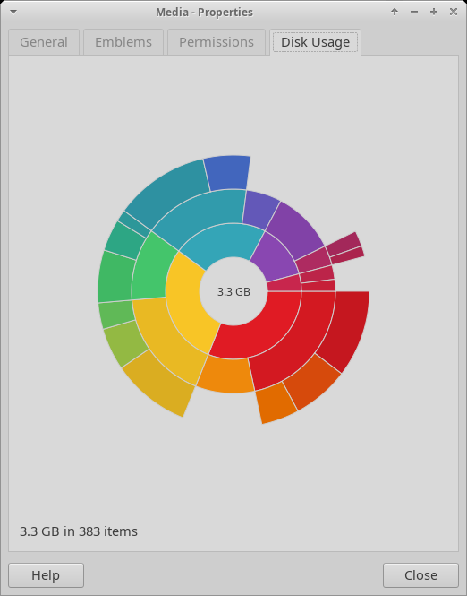

# Thunar disk usage plugin

A Thunar plugin that shows what takes up the space in a folder, as a ring chart
like the one in GNOME's Disk Usage Analyzer (Baobab):

- a **Disk Usage** tab in the *Properties* dialog of a folder;
- **Show Disk Usage** (Ctrl+Alt+U) in the context menu of a folder and of the
  folder background opens the same view in a window of its own.

It can also be a button in the toolbar: *View → Configure Toolbar…*, tick
**Show Disk Usage**. The button shows the current folder.

Thunar's shortcut editor does not list the items of plugins. To change the
shortcut, quit Thunar (`thunar -q`) and add a line to
`~/.config/Thunar/accels.scm`, e.g. for Ctrl+Shift+D, or `""` for none:

```
(gtk_accel_path "<Actions>/ThunarActions/uca-action-tdu-show-disk-usage" "<Primary><Shift>d")
```



Each ring is one level of sub folders, up to five levels deep. The chart grows
while the folder is scanned. Pointing at a segment shows the folder's name and
size; a click opens the folder in the chart, a click into the middle goes back
up, the scroll wheel shows more or fewer rings. The context menu of a segment
opens the folder in Thunar, copies its path or moves it to the trash.

Sizes are the space used on the disk (like `du`), hard-linked files are counted
once, and the scan stays on the file system of the folder (other mounts below it
are skipped, like `du -x`). Folders that cannot be read are counted in the
status line.

It works with the stock Thunar 4.18 and later; no Thunar package is replaced.
Translated into German and Russian.

## Install

Download the package for your system from
[Releases](https://github.com/gtubolcev/xfce-patches/releases/latest):

| System | File |
|---|---|
| Xubuntu 26.04 | `thunar-disk-usage-plugin_*~resolute_amd64.deb` |
| Xubuntu 24.04, Linux Mint 22 | `thunar-disk-usage-plugin_*~noble_amd64.deb` |
| Debian 13 | `thunar-disk-usage-plugin_*~trixie_amd64.deb` |
| Arch Linux, Manjaro, EndeavourOS | `thunar-disk-usage-plugin-*.pkg.tar.zst` |

```bash
sudo apt install ./thunar-disk-usage-plugin_*.deb    # or: sudo pacman -U ./thunar-disk-usage-plugin-*.pkg.tar.zst
thunar -q                                            # restart Thunar
```

On Ubuntu 26.04 and 24.04 it is also in the PPA, which keeps it updated:

```bash
sudo add-apt-repository ppa:gtubolcev/xfce-patches
sudo apt install thunar-disk-usage-plugin
```

The PPA also holds the patched xfce4-settings with the theme schedule, which
then replaces the stock one on the next upgrade.

## Build

```bash
sudo apt install meson gettext libthunarx-3-dev libgtk-3-dev
meson setup --prefix=/usr build && ninja -C build && sudo ninja -C build install
thunar -q
```

`-Dtests=true` also builds `tests/du-scan-test PATH` (prints the scan, to
compare with `du -sB1 -x PATH`) and `tests/du-view-test PATH` (the view in a
window, without Thunar).

## Credits

The ring chart is ported to C and GTK 3 from `baobab-chart.vala` and
`baobab-ringschart.vala` of [Baobab](https://gitlab.gnome.org/GNOME/baobab)
49.1 (Copyright © 2006–2008 Igalia, © 2013 Stefano Facchini), GPL-2.0-or-later.
The scanner, the view and the Thunar integration are new.

The code was written with an AI assistant (Claude) and has not been reviewed by
an Xfce developer.

## License

GPL-2.0-or-later, see [COPYING](COPYING).
